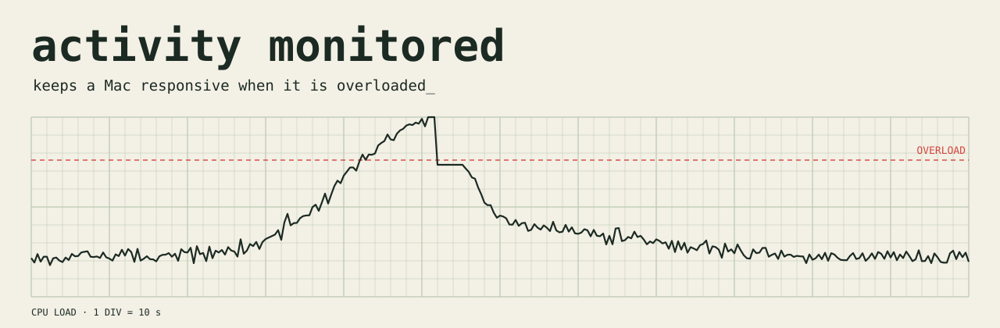

<picture>
  <source media="(prefers-color-scheme: dark)" srcset="art/banner-dark.svg">
  
</picture>

# Activity Monitored: keeps a Mac responsive when it is overloaded.

**Synthetic overload test: a 10-process job finished in 24.2 s instead of 39.3 s (one Mac, best case).**

**Activity Monitored keeps your Mac responsive when it is overloaded, and you never see it.** While too many programs fight for the CPU, it lowers the priority of the busy background ones. While memory runs out, it pauses the background program using the most memory, so it stops filling memory, and resumes it as soon as memory recovers. Every change undoes itself through a timer that runs even if Activity Monitored crashes. It never shows a pop-up.

## Install (about 30 seconds)

Open Terminal (press Cmd+Space, type `Terminal`, press Return), paste these lines, press Return after each:

```
git clone https://github.com/Questboy23/activity-monitored
cd activity-monitored
less install.sh      # read the script first, press q to leave
bash install.sh
```

Faster, if you trust the author: this one line runs the script without you reading it first.

```
curl -fsSL https://raw.githubusercontent.com/Questboy23/activity-monitored/main/install.sh | bash
```

No Terminal? Click **Download for Mac** on https://reedostrov.com/activity-monitored/, double-click the zip, then double-click `Install Activity Monitored.command`. The first time, macOS blocks it because it is not from the App Store: open System Settings, Privacy & Security, scroll down, click **Open Anyway**, then double-click it again.

It needs macOS and the Python that comes with Apple's Command Line Tools. If a window offers to install them, click Install, wait, then run the line again.

## Do I need an account?

No. Activity Monitored works with nothing else installed: no account, no API key, no network.

## Measured results

| Situation | Result | Basis |
|---|---|---|
| Synthetic test: a 10-process job against 24 busy background processes | 39.3 s down to 24.2 s (median of 3 runs each, 38% shorter) | measured once, one Mac, best case |
| Normal day, real workloads | not measured | no data |
| Mac not overloaded | no change | by design |
| Waiting on the network, a cloud AI, or the disk | no change | by design |
| Memory shortage | pauses the biggest background program; if only scripts started by an app (Python run by Claude, say) are left, it pauses the biggest of those | by design |
| Disk under the target (30 GB, `monitored disk-target GB`) | turns on macOS transparent compression for big idle files until target + 5 GB are free; test file 25 MB down to 2.5 MB, same bytes; first live hour: 634 files, 22.4 GB | test suite and one Mac |
| Disk under a third of the target while swap keeps growing | pauses the program using the most memory until half the target is free (swap files live on the same disk) | test suite |
| Disk under 3 GB free | pauses the program writing most to disk until half the target is free | test suite |
| Battery | about 2 to 3% of one CPU core while busy, 0.2% when calm; watts not measured | measured on one Mac |

The synthetic job is the best case: 24 processes that do nothing but spin. `bench_ab.py` reruns it (macOS only).

## What you will see

macOS shows a "Background Items Added" notice for `python3` the first time. That is the login item that keeps Activity Monitored running. It is expected, and `monitored uninstall` removes it.

## Safety

- For the CPU it lowers priority (`taskpolicy -b`), and on Apple silicon that also moves the program to the efficiency cores.
- For memory it pauses one background program at a time, at most 3, each for at most 10 minutes. It only pauses your own command-line work (scripts, builds, local servers, measured by macOS's own memory count). It never pauses an app with a Dock or menu bar icon, an app's helpers, a system program, the front app, protected work (calls, music, video, builds, AI agents), Claude or anything it started, or a background service launchd keeps running (LaunchAgents), even when memory or disk runs out. A paused program keeps all its memory and state.
- It never quits an app or deletes anything. A background script paused for 15 minutes that still holds over 2 GB of swap, with the disk under a third of the target, is ended; `monitored status` shows the command to rerun it. It never shows a notification. Disk and memory notes go to `monitored status` only.
- Disk relief deletes nothing. Compression is the same feature macOS uses for its own system files: programs read the file exactly as before. Each file is copied compressed, checked byte for byte, and swapped in only if it is not open, did not change, and shrank by at least 20%. Every compressed file is listed in `~/.monitored/compressed.jsonl`. `monitored uncompress` reverses it, and it reverses itself once the target + 30 GB are free (while target + 20 GB stay free). It skips Library, hidden folders, cloud-synced folders, files changed in the last 3 days, and media, archives and model files.
- Every slowdown has its own macOS timer (90 s). If Activity Monitored crashes or is removed, programs speed up again by themselves. Test: killing Activity Monitored right after a slowdown restored the program 6 s later.
- It never touches the app you are using and its helpers, system programs (WindowServer, Finder, Dock), Terminal, or media, call and developer tools (Spotify, Zoom, FaceTime, Discord, OBS, Logic Pro, GarageBand, Ableton, Music, Teams, Claude, ollama, pytest, cargo, npm run).
- Work you started on purpose is protected too: builds and tests, renders (ffmpeg, HandBrake, Final Cut, Premiere, DaVinci, Blender), virtual machines, containers, and local databases and servers. The full list is in `HOW_IT_WORKS.md`.
- Add your own: `monitored protect NAME`.
- It touches only your own programs, needs no admin password, and sends nothing anywhere by default.

## Commands

| Command | What it does |
|---|---|
| `monitored status` | what Activity Monitored is doing now and in the last 24 hours |
| `monitored watch` | log what it would do, change nothing |
| `monitored on` | act (default after install) |
| `monitored off` | stop and undo everything |
| `monitored battery on\|off` | battery saver: checks less often and makes no model calls on battery |
| `monitored protect NAME` | never touch programs whose command contains NAME |
| `monitored gate -- CMD` | start CMD once memory is not thrashing (waits at most 120 s; change with `--max-wait S`) |
| `monitored uninstall` | remove everything (`--purge` also deletes logs) |

## How it works

1. Every 6 to 10 s when calm (3 s when busy), it reads CPU use and memory pressure straight from the kernel. A calm check costs about 0.2% of one core.
2. When CPU use reaches about 72%, it lists your programs. One that stays above 20% CPU for 3 checks while the Mac is 75% busy, and is not protected, gets background priority.
3. It restores the program after the Mac has been calm for 3 checks (at least 30 s), or when the 90 s timer ends.

## Limitations

- macOS only. Tested on one MacBook Air (Apple silicon, macOS 26.7). Intel Macs and older macOS are untested.
- Early release (0.4.0). The only benchmark is synthetic, has 3 runs per arm and ran on one Mac. No speedup on real work is measured.
- Not compared against App Tamer, Process Lasso-style tools or plain macOS.
- `test_monitored.py` needs macOS. 23 of 23 pass on the author's Mac.
- Activity Monitored cannot free memory. It can only delay starting new jobs.
- A background program that the front app depends on (a local server, for example) can slow the front app when it is slowed. Add it with `monitored protect NAME`.
- If macOS cannot report which app is in front (rare), only the protected list guards you.
- Each slowdown is undone by a timer that names a process number. If that number is reused by another program within 90 s, the timer runs `taskpolicy -B` on it, which only removes background priority.
- The installer downloads `monitored.py` from the `main` branch. Read it first if you do not trust that branch.
- Defaults after install: mode `on` (acts), battery saver on. `monitored watch` logs without acting.

## More detail

`HOW_IT_WORKS.md` explains every step in plain words, then defines each technical term.

## Remove

```
monitored uninstall
```

## AI disclosure

Reed Ostrov designed the tool: the idea of lowering priority only while the Mac is overloaded, the protected-program lists and the plain-words documentation. Claude Code (Anthropic) wrote the code, the tests and the benchmark script, and ran the benchmark. Claude also audited this README in 2026-11 and removed estimates that had no measurement behind them.

## License

MIT. See `LICENSE`.
