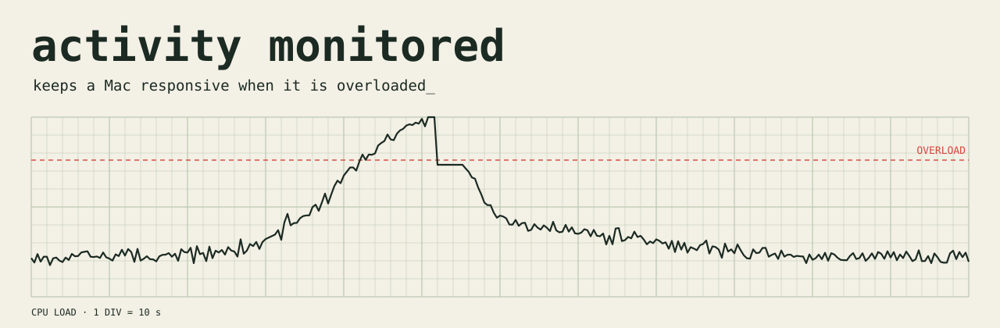

<picture>
  <source media="(prefers-color-scheme: dark)" srcset="art/banner-dark.svg">
  
</picture>

# Activity Monitored

**Activity Monitored keeps your Mac responsive when it is overloaded.** While too many programs fight for the CPU, it lowers the priority of the busy background ones, then restores them. Every change is undone automatically.

## Install (about 30 seconds)

Open Terminal (press Cmd+Space, type `Terminal`, press Return), paste this line, press Return:

```
curl -fsSL https://raw.githubusercontent.com/Questboy23/activity-monitored/main/install.sh | bash
```

No Terminal? Click the green **Code** button, choose **Download ZIP**, unzip it, then right-click `Install Activity Monitored.command` and choose **Open**.

It needs macOS and the Python that comes with Apple's Command Line Tools. If a window offers to install them, click Install, wait, then run the line again.

## Do I need Claude Code or an account?

No. Activity Monitored works with nothing else installed: no account, no API key, no network.

Optional: `monitored ai on` lets a Claude model judge unfamiliar situations. That runs the `claude` program already on your Mac with your own login, so it uses your usage and never the author's. It is off by default. `monitored privacy` shows exactly what would be sent.

## Estimated results

| Situation | Estimated effect | Basis |
|---|---|---|
| A build or test you wait on, while background programs compete for the CPU | 5 to 15% faster | estimate, low confidence |
| Synthetic test: a 10-process job against 24 busy background processes | 39.3 s down to 24.2 s (median of 3 runs each) | measured |
| Average over a normal day | about 1 to 3% | estimate, low confidence |
| Mac not overloaded | no change | by design |
| Waiting on the network, a cloud AI, or the disk | no change | by design |
| Memory shortage | frees nothing; `monitored gate` delays starting new jobs | by design |
| Battery | about 2 to 3% of one CPU core while busy, 0.2% when calm; watts not measured | measured on one Mac |

## What you will see

macOS shows a "Background Items Added" notice for `python3` the first time. That is the login item that keeps Activity Monitored running. It is expected, and `monitored uninstall` removes it.

## Safety

- It lowers priority only (`taskpolicy -b`), and on Apple silicon that also moves the program to the efficiency cores. A pause action exists in the code and is switched off.
- Every slowdown has its own macOS timer (90 s). If Activity Monitored crashes or is removed, programs speed up again by themselves. Test: killing Activity Monitored mid-pause resumed the program 8 s later.
- It never touches the app you are using and its helpers, system programs (WindowServer, Finder, Dock), Terminal, or media, call and developer tools (Spotify, Zoom, FaceTime, Discord, OBS, Logic Pro, GarageBand, Ableton, Music, Teams, Claude, ollama, pytest, cargo, npm run).
- Work you started on purpose is protected too: builds and tests, renders (ffmpeg, HandBrake, Final Cut, Premiere, DaVinci, Blender), virtual machines, containers, and local databases and servers. The full list is in `HOW_IT_WORKS.md`.
- Add your own: `monitored protect NAME`.
- It touches only your own programs, needs no admin password, and sends nothing anywhere by default.

## Commands

| Command | What it does |
|---|---|
| `monitored status` | what Activity Monitored is doing now and in the last 24 hours |
| `monitored watch` | log what it would do, change nothing |
| `monitored on` | act (default after install) |
| `monitored off` | stop and undo everything |
| `monitored battery on\|off` | battery saver: checks less often and makes no model calls on battery |
| `monitored ai on\|off` | optional Claude judgment (default off) |
| `monitored protect NAME` | never touch programs whose command contains NAME |
| `monitored gate -- CMD` | start CMD once memory is not thrashing (waits at most 30 s) |
| `monitored report` | log summary |
| `monitored uninstall` | remove everything (`--purge` also deletes logs) |

## How it works

1. Every 6 to 10 s when calm (3 s when busy), it reads CPU use and memory pressure straight from the kernel. A calm check costs about 0.2% of one core.
2. When CPU use reaches about 72%, it lists your programs. One that stays above 20% CPU for 3 checks while the Mac is 75% busy, and is not protected, gets background priority.
3. It restores the program after the Mac has been calm for 3 checks (at least 30 s), or when the 90 s timer ends.
4. Optional: a Claude model decides unfamiliar cases. Decisions are stored by program name and reused with no further calls.

## Limits

- macOS only. Tested on one MacBook Air (Apple silicon, macOS 26.7). Intel Macs and older macOS are untested.
- Early release (0.1.0). The benchmark is synthetic and the day-average figure is an estimate.
- Activity Monitored cannot free memory. It can only delay starting new jobs.
- A background program that the front app depends on (a local server, for example) can slow the front app when it is slowed. Add it with `monitored protect NAME`.
- If macOS cannot report which app is in front (rare), only the protected list guards you.

## More detail

`HOW_IT_WORKS.md` explains every step in plain words, then defines each technical term.

## Remove

```
monitored uninstall
```

## License

MIT. See `LICENSE`.
